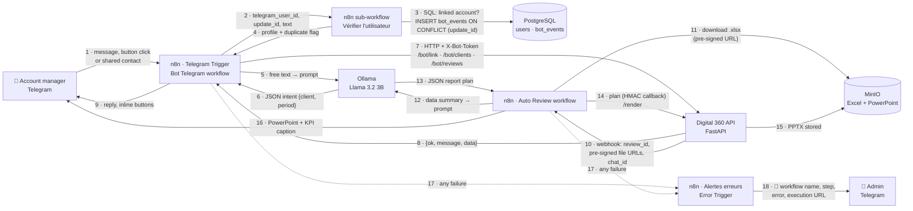
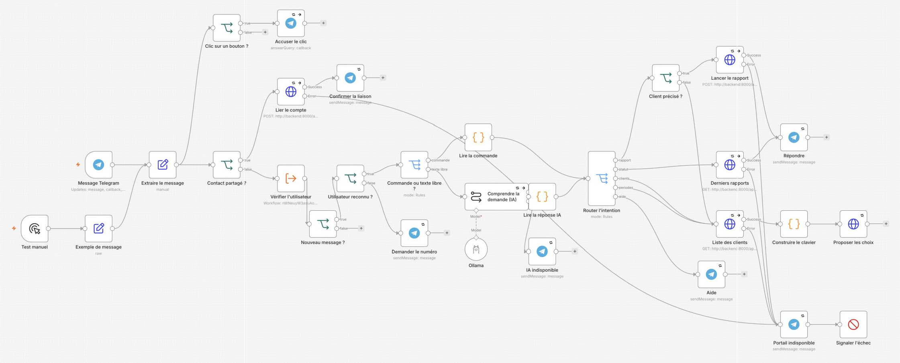
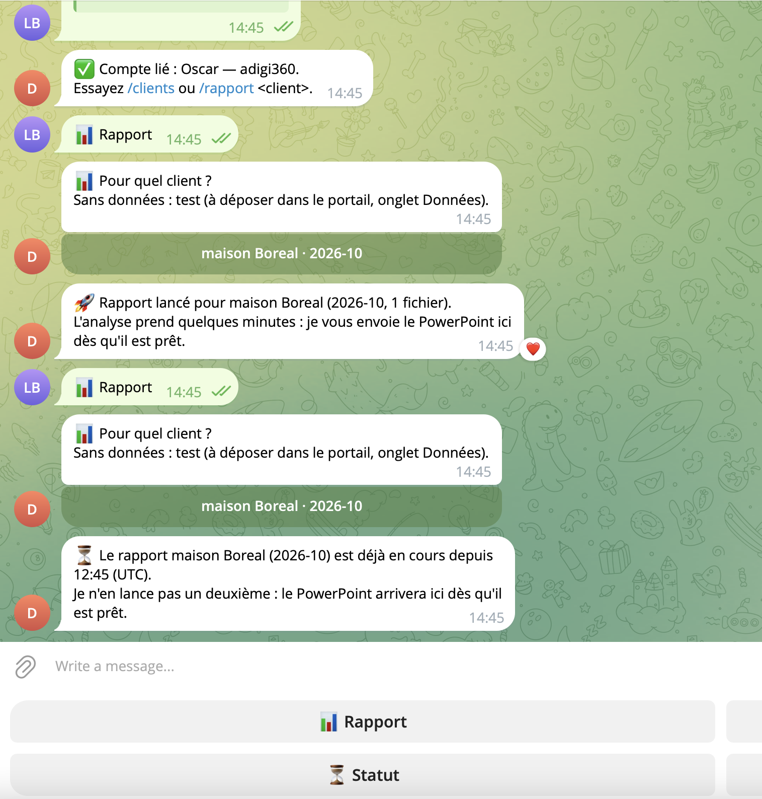
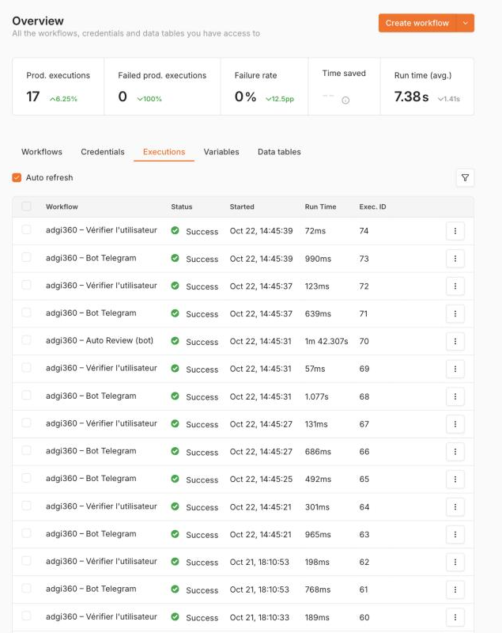

# Digital 360 × Telegram Bot

**n8n project — Louis Bettelli.** Level 3 (advanced).

> **Need, in one sentence.** Account managers in marketing agencies (Google, Meta,
> TikTok, LinkedIn… ads) build a monthly performance report per client **by hand**,
> from a computer, while they are often in client meetings or on the road. The bot
> lets them launch that report from their phone and get the PowerPoint back **in the
> same Telegram chat**, only if their phone number is registered in their agency.

The bot runs on top of **Digital 360**, my reporting portal (FastAPI + React). n8n is
the orchestrator; the portal builds the PowerPoint; the AI runs **locally** with
Ollama, so no client data leaves the server.

---

## Architecture



| Workflow (file in [`n8n/workflows/`](n8n/workflows)) | Role |
|---|---|
| **adgi360 – Bot Telegram** | Entry point (Telegram Trigger + manual test trigger), idempotence, routing, AI for free text, buttons |
| **adgi360 – Vérifier l'utilisateur** | Sub-workflow called by *Execute Workflow*: recognises the sender, logs every access, detects duplicates |
| **adgi360 Auto Review** | Webhook from the portal: Excel → summary → AI plan → PowerPoint → sent to Telegram |
| **adgi360 – Alertes erreurs** | Error workflow (Error Trigger) linked in the settings of the two main workflows |

**Level and cut line.** Level 3: sub-workflow, error handling with retries and an
error workflow, persistent state (Telegram link + access log in Postgres), several
chained services (Telegram, portal API, MinIO, Ollama). Planned cuts, in order, if
time ran out: (1) free-text understanding by the AI, (2) `/statut`, (3) sending the
file in Telegram. **Never cut:** the phone-number check and the `/rapport → answer in
Telegram` loop. In the end nothing had to be cut.

---

## Run it from a fresh clone

Prerequisites: Docker Desktop (or Docker Engine + Compose v2), Python 3.11+, Node 20+.

```bash
git clone https://github.com/Coachbet/digital-360.git && cd digital-360
cp .env.example .env
# fill in N8N_ENCRYPTION_KEY (openssl rand -hex 32) and TELEGRAM_BOT_TOKEN (@BotFather)
docker compose up -d          # PostgreSQL, MinIO (+ bucket), n8n — all with healthchecks
docker compose ps             # postgres, minio, n8n: healthy
```

Then the portal (it creates its tables on start-up):

```bash
cd Portail-backend
python -m venv .venv && source .venv/bin/activate
pip install -e ".[dev]" && cp .env.example .env     # set BOT_API_TOKEN=$(openssl rand -hex 32)
uvicorn adgi360.main:app --reload --app-dir src --port 8001

cd "../Portail-front end" && npm install && npm run dev   # http://localhost:5173
```

Then n8n (http://localhost:5678):

1. **Credentials** (exact names): `adgi360 Bot` (Telegram API), `adgi360 Bot API`
   (Header Auth, name `X-Bot-Token`, value = `BOT_API_TOKEN`), `adgi360 Postgres`
   (host `postgres`, port `5432`, values from `.env`), `Ollama local`
   (`http://host.docker.internal:11434`).
2. **Import** the four files of `n8n/workflows/` (⋯ › Import from file), sub-workflow and
   error workflow first.
3. Set **Settings › Error workflow = adgi360 – Alertes erreurs** on the Bot and Auto Review,
   put your Telegram chat id in *Alertes erreurs › Configuration*, then **Publish**.
4. Telegram only calls HTTPS webhooks: in local, expose n8n with
   `cloudflared tunnel --url http://localhost:5678` and set `WEBHOOK_URL` accordingly.
   On the server, `https://n8n.<domain>` is used.

Production (one OVH VPS, Caddy for HTTPS, nothing else exposed):
`docker compose -f deploy/docker-compose.prod.yml --env-file deploy/.env.prod --profile ollama up -d --build`
— details in [DEPLOIEMENT.md](DEPLOIEMENT.md).

### Environment variables

| Variable | Where | Purpose |
|---|---|---|
| `POSTGRES_USER` / `POSTGRES_PASSWORD` / `POSTGRES_DB` | `.env`, `deploy/.env.prod` | Project database (portal + bot access log) |
| `MINIO_ROOT_USER` / `MINIO_ROOT_PASSWORD` / `S3_BUCKET` | `.env`, `deploy/.env.prod` | File storage for Excel exports and PowerPoints |
| `N8N_ENCRYPTION_KEY` | `.env`, `deploy/.env.prod` | Encrypts the credentials stored by n8n — keep it |
| `TELEGRAM_BOT_TOKEN` | `.env`, `deploy/.env.prod` | Read by n8n with `{{ $env.TELEGRAM_BOT_TOKEN }}` — never written in a workflow |
| `BOT_API_TOKEN` | `Portail-backend/.env`, `deploy/.env.prod` | Shared secret: n8n → portal (`X-Bot-Token` header) |
| `SECRET_KEY`, `CREDENTIALS_ENCRYPTION_KEY` | `Portail-backend/.env`, `deploy/.env.prod` | Portal sessions and encrypted settings |

Only `*.example` files are versioned; `.env`, `deploy/.env.prod` and Docker volumes are
in `.gitignore`. Image versions are pinned (no `:latest`).

---

## How to test

| What | How | Expected |
|---|---|---|
| **On-demand trigger** | n8n › Bot Telegram › *Execute workflow* on **Test manuel** (saved test payload next to the real trigger) | The bot answers `/clients` in Telegram |
| Link the account | `/start` → **📱 Share my number** | “✅ Compte lié : …” (number must match the agency) |
| Main scenario | **📁 Clients** → tap a client | “🚀 Rapport lancé”, then the PowerPoint with KPI caption ≈ 1–2 min later |
| Second scenario | **⏳ Statut** or free text “fais-moi le rapport de maison boreal” | Latest reports / AI turns the sentence into a command |
| Invalid input | `/rapport clientinconnu`, `/rapport` alone, `/blabla` | Usage message, client buttons, or help |
| **Idempotence** | Tap the same client button twice | One report only; the 2nd tap answers “⏳ déjà en cours” (no new row, no 2nd AI run). Telegram re-deliveries (same `update_id`) are ignored |
| **Live failure** | Stop the portal (`docker compose … stop backend`) and send `/statut` | 3 retries, “⚠️ Portail indisponible” to the user, 🚨 alert with execution URL to the admin |
| Security | Forward somebody else's contact to the bot | Refused (“contact d'une autre personne”) |
| Unit tests | `cd Portail-backend && pytest -q` | 33 passed |

### Screenshots

| Bot workflow | Telegram | Executions |
|---|---|---|
|  |  |  |

---

## Evaluation checklist — where each point is

| Criterion | Where |
|---|---|
| Message trigger (Telegram) | *Message Telegram* (Telegram Trigger) |
| API with stored credential | *Lier le compte*, *Liste des clients*, *Lancer le rapport* (Header Auth `adgi360 Bot API`) |
| If / Set shaping data | *Extraire le message* (Set), *Contact partagé ?*, *Nouveau message ?*, *Utilisateur reconnu ?* (If) |
| Code with real logic | *Lire la commande* (parser), *Construire le clavier*, *Résumer les données*, *Valider le plan* |
| Switch with ≥ 2 reachable paths | *Router l'intention* (rapport / statut / clients / périodes / aide) |
| Database | PostgreSQL: linked account read, `bot_events` written (state across runs) |
| AI node with system prompt | *Comprendre la demande (IA)* — Basic LLM Chain + Ollama Chat Model |
| Sub-workflow with defined inputs | *Vérifier l'utilisateur* (Execute Workflow) |
| Retry on every external call | 3 tries, 3 s wait on every HTTP, Telegram, Postgres and AI call |
| Error workflow | *Alertes erreurs* (Error Trigger) — workflow name, step, error, execution URL |
| AI output validated + fallback | *Lire la réponse IA*, *Valider le plan* (schema checks, fallback to help / failure path) |
| Idempotence | `bot_events.update_id` unique + *Nouveau message ?*; portal refuses a duplicate running report |
| Secrets | none in Git; Telegram token only in env |

## Repository layout

```
Portail-backend/      FastAPI (DDD) — bot routes in application/bot, tests in tests/unit
Portail-front end/    React + Vite — Telegram card in the agency page
n8n/workflows/        exported workflows, exactly the version shown in the demo
n8n/build_cours.py    generator used while building the workflows
deploy/               production compose, Caddyfile, backup script
docker-compose.yml    local stack: PostgreSQL + MinIO + n8n
```
